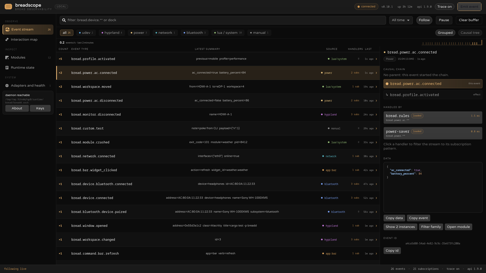
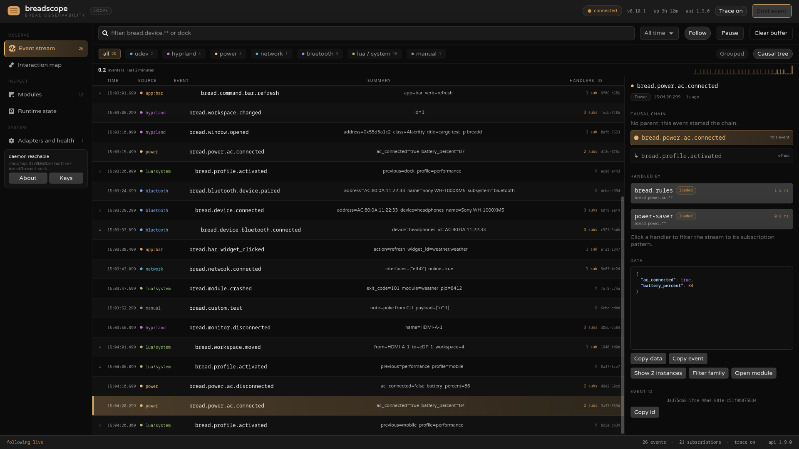
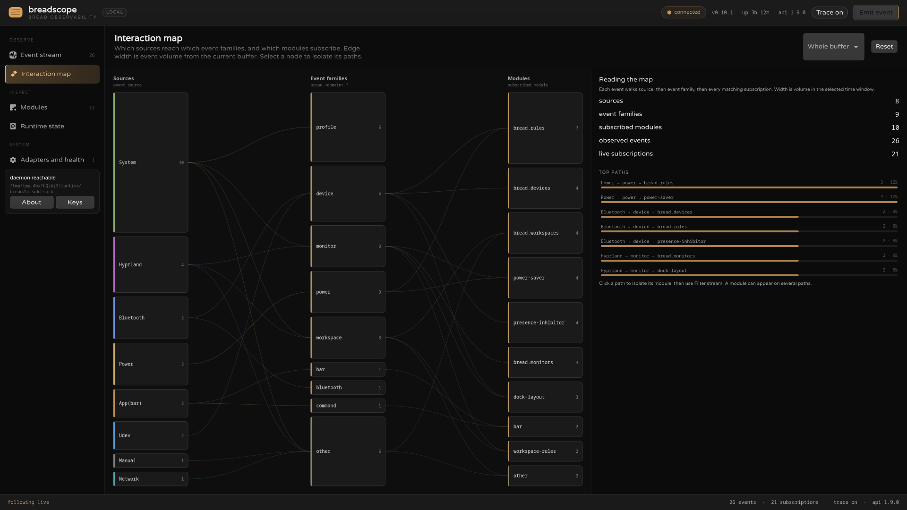
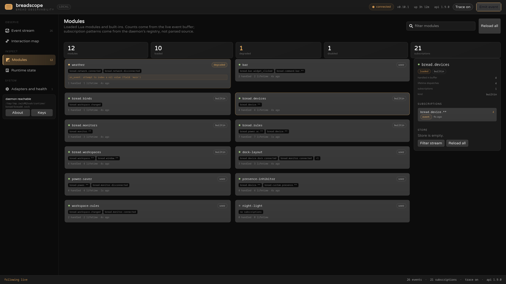
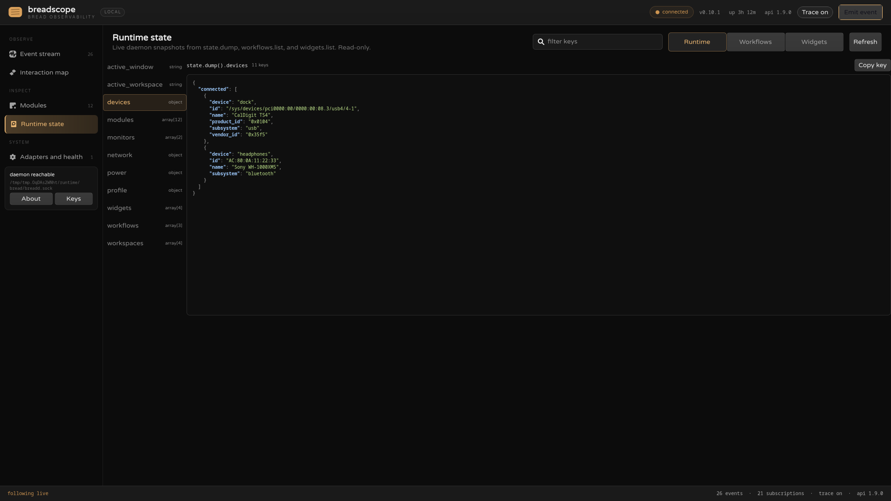

# breadscope

A GTK4 observability window for [bread](../README.md). It shows live events and
their causal chains, the modules subscribed to each event, handler timings, the
interaction map, runtime state, workflows, widgets, and adapter health.

`breadscope` is a read-mostly client: it talks to `breadd` over the same local
Unix socket as `bread`, never opens a network listener, and never edits runtime
state. The only writes are the documented `emit`, `trace.set`, and
`modules.reload` IPC methods.











Screenshots use the development fake daemon; the
[`stream-real-daemon.png`](docs/screenshots/stream-real-daemon.png) image is
the same window against a real `breadd`.

## Run

```bash
breadscope                 # event stream
breadscope --view flow     # open on the interaction map
breadscope --view modules
breadscope --view state
breadscope --view state --tab workflows
breadscope --view state --tab widgets
breadscope --view adapters
```

The window follows breadd on `$XDG_RUNTIME_DIR/bread/breadd.sock` (or the
`daemon.socket_path` override in `~/.config/bread/breadd.toml`) and reconnects
automatically if the daemon restarts.

## Views

- **Event stream**: live subscription plus a replay of the last two minutes,
  pattern and source filters with live counts, and time windows (all, 1m, 5m,
  15m). The default **Grouped** table shows one row per event type with its
  instance count, latest summary, source, and handler count; toggle it off for
  the chronological table with causal indentation and per-event IDs. **Raw**
  and **Legacy** chips reveal the `bread.hyprland.event` firehose and the
  compatibility `bread.hyprland.*` names, both hidden by default. The inspector
  shows the causal chain, matching subscriptions, exact handler timings,
  downstream effects, and a syntax-highlighted payload. An event-rate sparkline
  and follow mode sit above the table.
- **Interaction map**: sources to event families to modules, with edge width by
  observed volume and a selectable time window. Hover a node for its count,
  click to isolate its paths, and click a ranked path to isolate its module.
  Low-volume tails fold into an `other` node so the map stays readable.
- **Modules**: searchable status cards, builtin/user/degraded badges, live
  subscription patterns and counts, lifetime dispatches, store, and the
  daemon's last error. Click a subscription to filter the stream to it.
- **Runtime state**: a searchable key list, syntax-highlighted `state.dump`
  values, the workflow table, and a rendered preview of every registered widget
  tree.
- **Adapters and health**: adapter cards, daemon metadata, buffer size, and the
  recent handler errors breadd reported.

## Handler timing

The inspector's "Handled by" section shows exact per-handler duration only when
tracing is on. `breadscope` enables it on startup and clears it on exit; the
header's **Trace on** toggle can turn it off manually. With tracing off, the
inspector falls back to the matching subscription list and lifetime counts.

Tracing is a bounded in-memory ring in `breadd` (1024 entries, no I/O). Events
that arrived before tracing was enabled show "timing unavailable" rather than a
fabricated number.

## Keys

- `Ctrl+F` or `/`: focus the event filter.
- `F2` or `Ctrl+Shift+E`: open the emit dialog. `Ctrl+Enter` publishes, `Esc`
  closes.
- `Space`: pause or resume the stream.
- `Up`/`Down`, `PgUp`/`PgDn`, `Home`/`End`: move the event selection. Selecting
  an event turns off follow mode and scrolls the row into view.
- `f`: toggle follow mode.
- `g`: toggle the grouped event table.
- `r`: show or hide raw Hyprland events.
- `l`: show or hide legacy Hyprland event names.
- `t`: toggle handler tracing.
- `Esc`: clear the filter and release the selection.
- `?`: show the full shortcut list.

Window size, view, filter, source, ordering, follow mode, time windows, and the
Grouped/Raw/Legacy toggles are remembered in
`~/.local/state/breadscope/session.json`.

The emit dialog mirrors breadd's reserved-domain guard: a manual emit cannot
forge `bread.power.*`, `bread.hyprland.*`, and the other adapter-owned domains,
but a well-formed `bread.command.<app>.<verb>` is accepted.

## Build

This crate is deliberately its own workspace, like `breadbug-gui`, so the daemon
and CLI do not need GTK development headers.

```bash
cd breadscope
cargo build --release --locked
```

Requires `gtk4` development files and the shared `bread-theme` stylesheet at
runtime. It is packaged as part of the `bread` bakery product.

## Development

`dev/fake_breadd.py` speaks the IPC subset breadscope uses and seeds a realistic
desktop with a causal chain every few seconds. Two harnesses use it:

```bash
# One screenshot on a private headless Sway output (no live desktop access).
dev/screenshot.sh stream /tmp/breadscope.png
dev/screenshot.sh flow /tmp/flow.png

# A persistent private session for interactive checks.
dev/headless.sh
source /tmp/breadscope-headless.env
grim /tmp/shot.png
dev/headless.sh stop
```

Both create a throwaway `XDG_RUNTIME_DIR`, start their own fake daemon and
compositor, and never touch the running session. `dev/broadway.sh` is the older
Broadway harness; the Sway harness is the maintained one because it also
supports input and `grim` screenshots.

## IPC surface used

`events.subscribe`, `events.replay`, `health`, `modules.list`,
`modules.reload`, `subscriptions.list`, `state.dump`, `workflows.list`,
`widgets.list`, `trace.set`, `events.trace`, `emit`.

`subscriptions.list`, `trace.set`, and `events.trace` were added in Bread
Automation API 1.9.0 for this app; the rest predate it.
