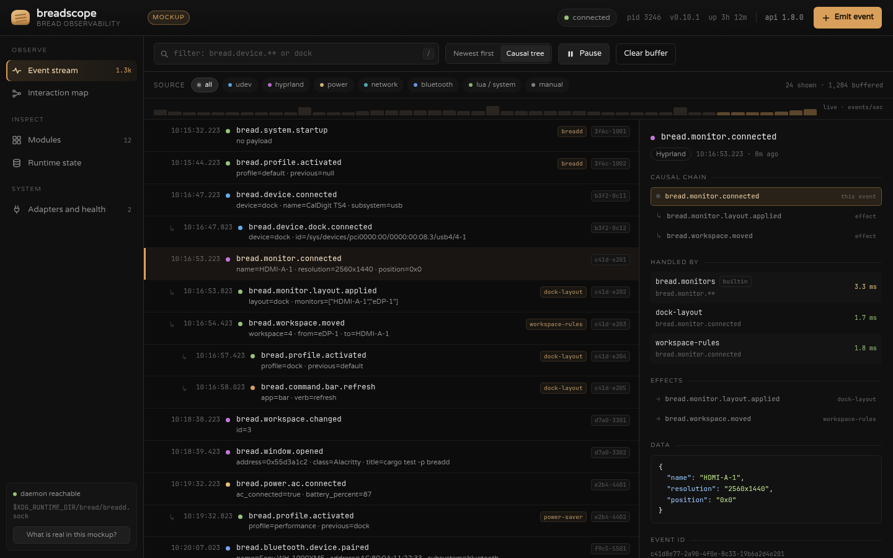
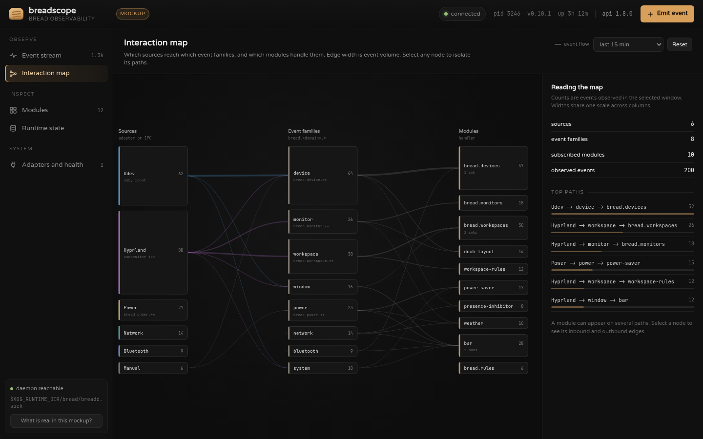

# breadscope mockup

A design mockup of a GUI for observing bread: live events, causality, module
subscriptions, runtime state, workflows, widgets, and adapter health.

Open `breadscope.html` directly in a browser. It is one self-contained file
with no network or build step. The event ticker is simulated; the layout,
filtering, causal tree, flow map, and dialogs are interactive.

## Why this exists

`bread events --tree` shows causality for one stream and `bread state` shows a
snapshot, but there is no single place to see which modules exist, what they
subscribe to, what they emit, and how an event travelled through them. That gap
makes cross-module bugs slow to reason about.

## Views

- **Event stream**: pattern and source filters, flat or causal ordering,
  volume strip, and an inspector with the causal chain, matching handlers,
  effects, and full data.
- **Interaction map**: a Sankey-style view of sources, event families, and
  modules, with per-node isolation and volume-ranked paths.
- **Modules**: status, kind (builtin, user, sandboxed), subscription counts,
  store, hooks, recent emits, and a live error for degraded modules.
- **Runtime state**: the `state.dump` shape by key, plus workflow instances and
  rendered widget trees.
- **Adapters and health**: adapter liveness, last event, buffer pressure,
  subscription counts, and recent handler errors.
- **Emit event**: a manual IPC emit with the reserved-domain guard reproduced.

## Backed by existing IPC

- `events.subscribe`, `events.replay` (`since_ms`)
- `caused_by` and `id` on `BreadEvent`
- `health` (version, uptime, adapters, subscriptions, recent errors)
- `modules.list`, `state.dump`, `state.get`
- `workflows.list`, `widgets.list`, `profile.list`, `profile.activate`
- `emit`

## IPC additions the full design needs

1. **Subscriptions per module.** `modules.list` reports name, status, builtin,
  and store, but not the event patterns a module registered. Add
  `subscriptions.list` returning `{ module, pattern, count, last_event, last_at }`,
  or extend `modules.list`. Without it, the module cards and the "Handled by"
  inspector rows can only be approximated by parsing Lua source.
2. **Dispatch trace for an event.** There is no way to learn which handlers ran
   for an event or how long they took. A debug-mode `events.trace` stream, or a
   per-event `handlers` array recorded only while tracing is enabled, would make
   the latency column and the interaction map exact. This must stay opt-in so
   the hot path is unchanged when it is off.
3. **Event volume history.** The API exposes a ring of recent events, but not
   counts over time. Either keep the histogram client-side or add
   `events.stats` with per-minute buckets.
4. **Per-module reload.** `modules.reload` reloads the whole Lua runtime. A
   `modules.reload { name }` variant (or `module.reload`) would let a card
   reload one module without disturbing every other module's store.

## Implementation notes

The ecosystem's GUIs are GTK4 on the shared `bread-theme` stylesheet, so a
GTK4 build is the consistent choice. The interaction map is the one hard part:
it needs either a custom `DrawingArea` with Cairo, or a WebKit view embedding
this HTML. A thin local HTTP UI served by `breadd` was rejected as a default
because it adds a listening socket and an auth surface for what is a
single-user debug tool; if the web route is chosen, bind to the user socket or
localhost only and authenticate with a token.

The name `breadscope` is provisional. `breadlens`, `breadtrace`, and
`breadview` are the other candidates that fit the existing naming.
